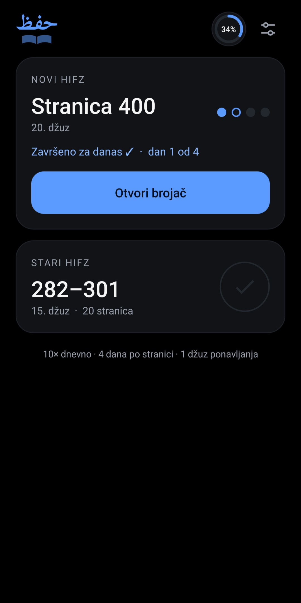
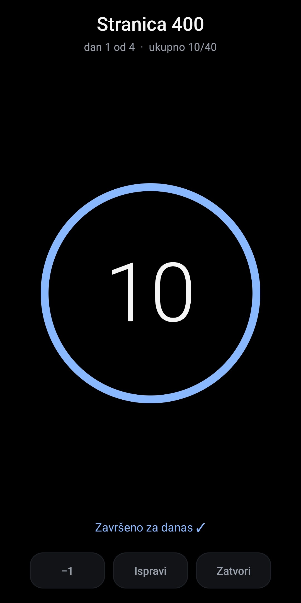

# Hifz

**📱 Android:** [preuzmi najnoviju verziju (APK)](https://github.com/amarhusika/hifz/releases/download/v1.0/hifz.apk)  
**📖 Hifz program:** [kako naučiti Kur'an napamet](https://islamski-resursi.pages.dev/hifz-program)

  
  

Minimalistička Android aplikacija za hifz Kur'ana.

- Novi hifz: jedna stranica 10× dnevno, 4 dana (ukupno 40×), od 604 unazad
- Brojač preko cijelog ekrana: dodir bilo gdje = +1, uz −1 i ručnu ispravku
- Stari hifz: jedan džuz dnevno (1–21, 22–41 … 582–604), pa ispočetka
- Napredak u procentima, traka mushafa i procijenjeni dan završetka
- Postavke: trenutna stranica novog hifza i džuz starog hifza

Svijetla i tamna tema prate sistem.
Bez biblioteka, bez interneta i bez rada u pozadini.

## Pokretanje

1. U Android Studiju otvorite ovaj folder.
2. Sačekajte da se završi Gradle sinhronizacija.
3. Povežite uređaj ili pokrenite emulator i odaberite **Run**.

Potreban je Android 8.0 ili noviji.
